<h3 align="center">معيض سالم ال حمامه · مهندس شبكات</h3>

  
  
  

  
  
  

---

### 👨‍💻 About me

CCNA-certified network engineer, licensed by the Saudi Council of Engineers, with a **Bachelor's degree in Applied Network Systems Engineering**. Hands-on experience managing local networks, configuring routers and switches, monitoring and analyzing network performance with **PRTG** and **Wireshark**, and resolving technical issues to keep operations running. Building my path from networking and infrastructure toward **cybersecurity**.

> 🎯 Open to **Network Engineer, Infrastructure, Cybersecurity and IT Support** roles.

### ⚡ What I do

- 🌐 **Design & configure networks** — routers, switches, LAN/VLAN, redundancy and failover
- 📊 **Monitor & analyze performance** — bandwidth, latency, packet loss and traffic analysis with PRTG and Wireshark
- 🔐 **Secure the infrastructure** — firewall rules, SSH, encryption and Layer 2 protection
- 🛠️ **Keep operations running** — troubleshooting hardware, systems and connectivity issues
- 📚 **Currently** — deepening my cybersecurity skills (tools, pen-testing and threat hunting)

### 🛠️ Skills & tools

  
  
  
  
  
  
  
  
  
  

### 🏥 Featured project

**[Establish & Secure the Network Infrastructure of King Khalid Hospital, Najran](https://muidh-alhamamah.github.io/#projects)** · *Graduation project, team of 4*

Secure, high-performance network connecting three hospital buildings over fiber with redundancy and failover; VoIP, wireless and IoT integration; Web, Email, File-storage and DNS servers; protected with firewall rules, SSH, encryption and Layer 2 security. Built and validated in Cisco Packet Tracer — research report and simulation file available on the [portfolio](https://muidh-alhamamah.github.io/#projects).

### 📜 Certifications & licenses

| Credential | Issuer | Date |
|---|---|---|
| Cisco Certified Network Associate (CCNA) | Cisco | Mar 2026 · valid to Mar 2029 |
| Engineering License | Saudi Council of Engineers | Licensed |
| Spark Infrastructure & Networking Track – Elevate | King Khalid University | Sep 2025 |
| Spark Program | King Khalid University | Apr 2025 |

### 💼 Experience

| Role | Organization | Period |
|---|---|---|
| Network Analyst | Services Excellence for Operations and Maintenance | Nov 2025 – May 2026 |
| Technical Support Trainee | Najran Municipality | Jan 2022 – Mar 2022 |

### 🎓 Education

| Degree | Institution | Years |
|---|---|---|
| B.Eng. Applied Network Systems Engineering | Technical College — TVTC | 2023 – 2025 |
| Diploma in Computer Technical Support | Technical College — TVTC | 2019 – 2022 |

---

🌐 <a href="https://muidh-alhamamah.github.io/">muidh-alhamamah.github.io</a> · Arabic / English

